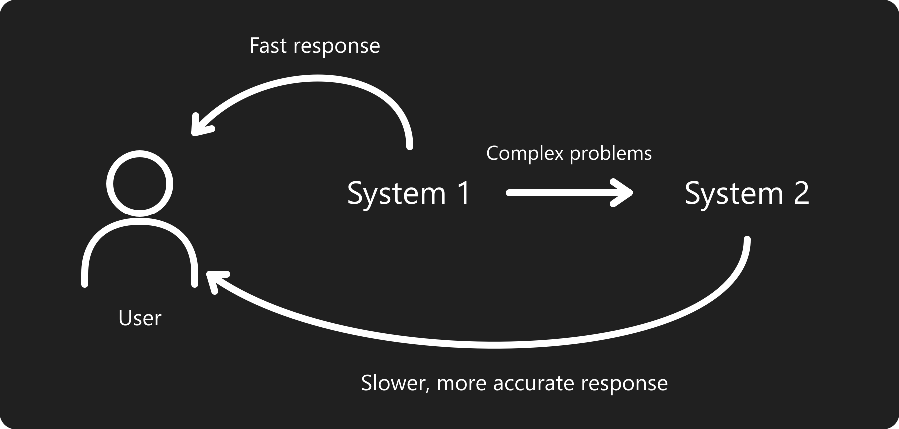
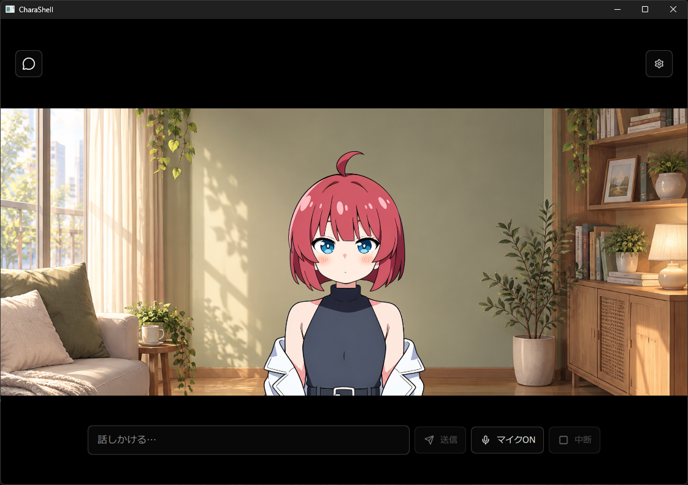

# CharaShell

[日本語](README.md) | English

## Purpose

CharaShell is a project to build a character interface for AI that performs tasks such as search and software development. The goal is to let users give voice or text requests to a desktop character and receive progress updates and results through the character's responses.

### System 1 and System 2

- **System 1** provides fast responses and passes complex problems to System 2.
- **System 2** takes more time to reason through problems and provide more accurate answers.

The current implementation uses a local Gemma model for System 1 and the Sarashina API for System 2. Integration with search and development tools is planned for future development.

## Screenshot

## Building

On Windows x64, install Qt 6.5 or later with an MSVC x64 kit and the matching C++ build tools.

1. Open `CharaShell.pro` in Qt Creator.
2. Select the MSVC x64 Qt kit and the Release configuration.
3. Click **Build**.

After building, click **Run** to launch the application. Any missing models are downloaded automatically on first launch.

If the dependency headers and DLLs have not been prepared, run `scripts/prepare-qtcreator.ps1 -QtPrefix <Qt-installation-path>` once to set them up.

## Acknowledgements

CharaShell uses or draws on the following software, models, and public implementations. Thank you to everyone involved in developing, researching, and sharing them.

| Project | Use in CharaShell |
| --- | --- |
| [miniaudio](https://github.com/mackron/miniaudio) | Microphone input and audio playback |
| [speech.cpp](https://github.com/nyosegawa/speech.cpp) | C++ inference for speech recognition and synthesis |
| [Haas-ja GGUF](https://huggingface.co/sakasegawa/Haas-ja-v1.0-GGUF) | Japanese speech recognition |
| [llama.cpp](https://github.com/ggml-org/llama.cpp) | Local LLM inference |
| [Google Gemma 4 E2B IT QAT](https://huggingface.co/google/gemma-4-E2B-it-qat-q4_0-gguf) | Conversational response generation |
| [Irodori-TTS](https://huggingface.co/Aratako/Irodori-TTS-v4.1-Small-MF) / [GGUF version](https://huggingface.co/sakasegawa/Irodori-TTS-v4.1-Small-MF-GGUF) | Japanese speech synthesis |
| [Sarashina API](https://docs.sarashina.ai/) | System 2 response generation |
| [Lucide](https://lucide.dev/) | UI icons |

CharaShell's source code is provided under the [MIT License](LICENSE). Bundled assets and third-party components remain subject to their own licenses and terms of use.
