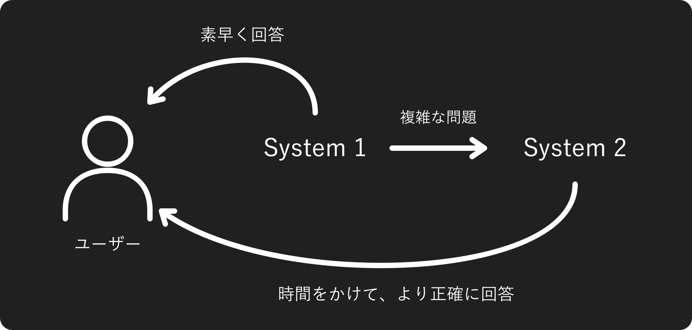
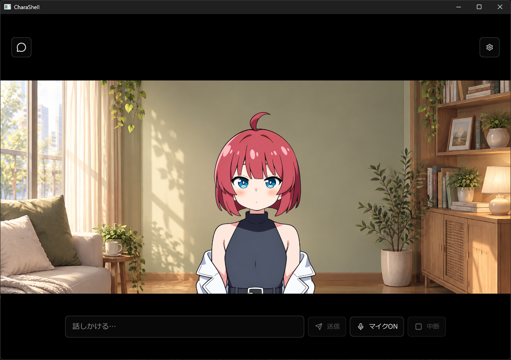

# CharaShell

## リポジトリの目的

CharaShellは、検索や開発を行うAIのためのキャラクターインターフェースを作るプロジェクトです。デスクトップ上のキャラクターに音声やテキストで作業を依頼し、進捗や結果をキャラクターの応答として受け取れる環境を目指しています。

### System 1とSystem 2

- **System 1**：素早く回答し、複雑な問題はSystem 2へ引き継ぎます。
- **System 2**：時間をかけて考え、より正確な回答を行います。

現在はSystem 1にローカルのGemma、System 2にSarashina APIを使用しています。検索・開発ツールとの連携は今後の開発対象です。

## 使用画面

## ビルド方法

Windows x64で、Qt 6.5以上のMSVC x64キットと対応するC++ビルドツールを用意します。

1. Qt Creatorで`CharaShell.pro`を開きます。
2. MSVC x64のQtキットとRelease構成を選択します。
3. 「ビルド」ボタンを押します。

ビルド後は「実行」ボタンで起動できます。初回起動時に不足しているモデルを自動取得します。

依存ヘッダー・DLLが未準備の場合は、`scripts/prepare-qtcreator.ps1 -QtPrefix <Qtのインストール先>`で初回準備を行ってください。

## 謝辞

CharaShellは、以下のソフトウェア・モデル・公開実装を利用、または参考にしています。開発・研究・公開に携わる皆さまに感謝します。

| プロジェクト | CharaShellでの用途 |
| --- | --- |
| [miniaudio](https://github.com/mackron/miniaudio) | マイク入力と音声再生 |
| [speech.cpp](https://github.com/nyosegawa/speech.cpp) | 音声認識・音声合成のC++推論 |
| [Haas-ja GGUF](https://huggingface.co/sakasegawa/Haas-ja-v1.0-GGUF) | 日本語音声認識 |
| [llama.cpp](https://github.com/ggml-org/llama.cpp) | ローカルLLMの推論 |
| [Google Gemma 4 E2B IT QAT](https://huggingface.co/google/gemma-4-E2B-it-qat-q4_0-gguf) | 会話文の生成 |
| [Irodori-TTS](https://huggingface.co/Aratako/Irodori-TTS-v4.1-Small-MF) / [GGUF版](https://huggingface.co/sakasegawa/Irodori-TTS-v4.1-Small-MF-GGUF) | 日本語音声合成 |
| [Sarashina API](https://docs.sarashina.ai/) | System 2の応答生成 |
| [Lucide](https://lucide.dev/) | UIアイコン |

CharaShellのソースコードは[MIT License](LICENSE)で提供します。同梱素材や第三者コンポーネントには、それぞれのライセンス・利用条件が適用されます。
